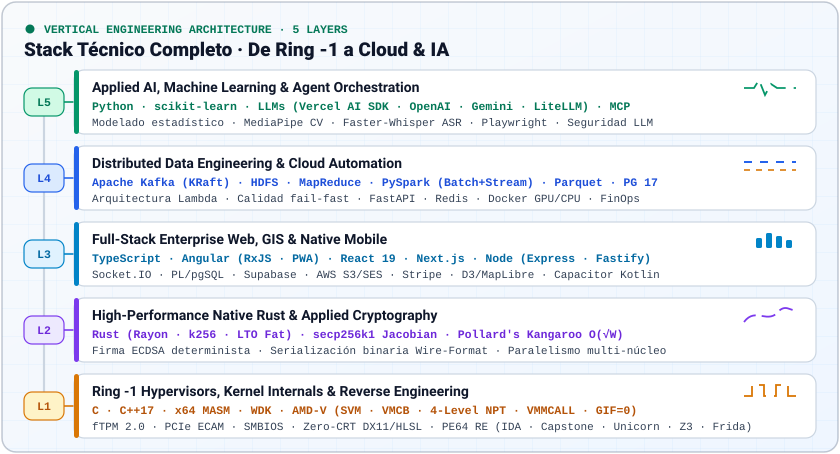
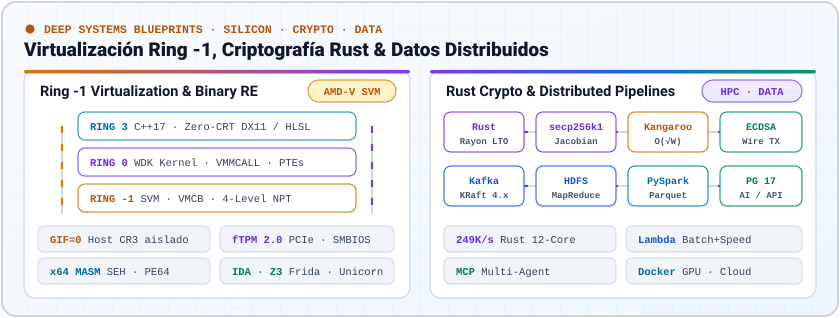
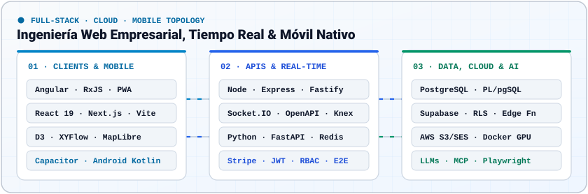

# Milov-ai

Ingeniería de sistemas de extremo a extremo: virtualización Ring -1 (AMD-V SVM/NPT), kernel Windows e ingeniería inversa, criptografía nativa en Rust, pipelines de datos distribuidos, aplicaciones Full-Stack/Móvil e IA aplicada.

<picture>
  <source media="(prefers-color-scheme: dark)" srcset="./assets/hero-dark.svg">
  <source media="(prefers-color-scheme: light)" srcset="./assets/hero-light.svg">
  
</picture>

## Arquitectura técnica: de Ring -1 a Cloud & IA

<picture>
  <source media="(prefers-color-scheme: dark)" srcset="./assets/stack-layers-dark.svg">
  <source media="(prefers-color-scheme: light)" srcset="./assets/stack-layers-light.svg">
  
</picture>

## Sistemas de bajo nivel, criptografía nativa y pipelines distribuidos

<picture>
  <source media="(prefers-color-scheme: dark)" srcset="./assets/systems-deepdive-dark.svg">
  <source media="(prefers-color-scheme: light)" srcset="./assets/systems-deepdive-light.svg">
  
</picture>

## Ingeniería Full-Stack, Cloud y Móvil

<picture>
  <source media="(prefers-color-scheme: dark)" srcset="./assets/engineering-matrix-dark.svg">
  <source media="(prefers-color-scheme: light)" srcset="./assets/engineering-matrix-light.svg">
  
</picture>

## Matriz técnica indexable

| Dominio de ingeniería | Arquitecturas, protocolos y tecnologías |
| :--- | :--- |
| **Ring -1 Hypervisors, Kernel & Reverse Engineering** | `C`, `C++17`, ensamblador `x64 MASM`, Windows `WDK` / internals de kernel, hipervisores `AMD-V (SVM)` (`VMCB`, `#VMEXIT`, `GIF=0`, `Host CR3`, `4-Level NPT`, `VMMCALL`), telemetría hardware/firmware (`fTPM 2.0`, `PCIe ECAM`, `SMBIOS`, `ACPI`), binarios nativos `Zero-CRT` (`/NODEFAULTLIB`), `DirectX 11` / `DXGI` / `Direct2D` / `HLSL`, análisis estático y dinámico de binarios `PE64` (`IDA`, `Capstone`, `Unicorn`, `Z3`, `Frida`, `WinDbg/CDB`) |
| **Native Rust & Applied Cryptography** | `Rust` (`Rayon`, `k256`, `sha2`, `ripemd`, `lto="fat"`), aritmética proyectiva Jacobiana sobre curva elíptica `secp256k1`, resolución sub-exponencial con `Pollard's Kangaroo O(√W)`, firma `ECDSA` determinista, serialización binaria `Wire-Format` y orquestación híbrida `Rust + Python` |
| **Distributed Data & Cloud Automation** | `Apache Kafka` (`KRaft`), `Hadoop HDFS` y `MapReduce`, `PySpark` (Batch y Structured Streaming), almacenamiento columnar `Parquet`, arquitecturas `Lambda`, calidad de datos `fail-fast`, idempotencia y watermarks, `PostgreSQL 17`, `FastAPI`, `Redis`, `Docker` (`CPU/GPU`), workers autónomos en la nube y auditoría `FinOps` multi-cloud |
| **Full-Stack Web, GIS & Native Mobile** | `TypeScript`, `Angular` (`RxJS`, `Angular Material`, `PWA`, `Leaflet`, `ApexCharts`), `React 19`, `Next.js`, `Vite`, `Tailwind CSS`, `Node.js` (`Express`, `Fastify`, `Socket.IO`, `Knex`, `OpenAPI`), `PostgreSQL` / `PL/pgSQL`, `MySQL`, `Supabase` (`RLS`, `Edge Functions`), `AWS` (`S3`, `SES`), `Stripe`, visualización (`D3-Force`, `React Flow`, `MapLibre`, `Recharts`, `GSAP`, `Framer Motion`), `Capacitor` + `Android` (`Kotlin`/`Java`, biometría y geolocalización), pruebas `Vitest` y `Playwright` |
| **Applied AI, ML & Agent Orchestration** | `Python`, `scikit-learn`, modelado estadístico y supervisado (`Random Forest`, `GLMs`, `Ridge/Lasso`), visión por computadora (`MediaPipe`), audio (`Faster-Whisper` ASR, TTS), orquestación multi-modelo de `LLMs` (`Vercel AI SDK`, `OpenAI`, `Gemini`, `LiteLLM`), servidores `MCP` (*Model Context Protocol*), flujos multi-agente y seguridad adversarial en `LLMs` |
